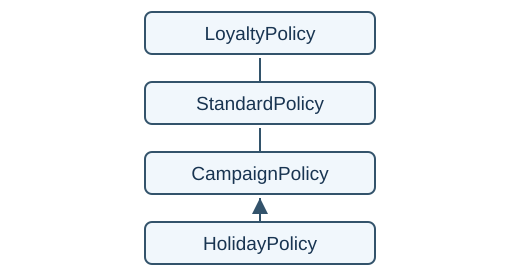

# Политики начисления бонусов

Учебный проект ЛР № 3. Он моделирует базовое начисление и надбавки для акций на примере бонусной программы «Форштадт».

## Пример начисления


## Формула стандартного начисления

<p><math xmlns="http://www.w3.org/1998/Math/MathML" display="block"><mi>B</mi><mo>=</mo><mn>5</mn><mo>·</mo><mo>⌊</mo><mfrac><mi>P</mi><mn>10000</mn></mfrac><mo>⌋</mo></math></p>

`P` — оплаченная сумма в копейках, `B` — начисленные бонусы. Для акции с положительной суммой оплаты к результату прибавляется фиксированная надбавка.

## Граф наследования



Стрелки идут от подкласса к базовому классу.

## Сборка HTML

```sh
npm install
npm run docs
```

В локальном HTML-портале откройте `docs/index.html`. Список классов и ссылки на исходники формируются JSDoc.
